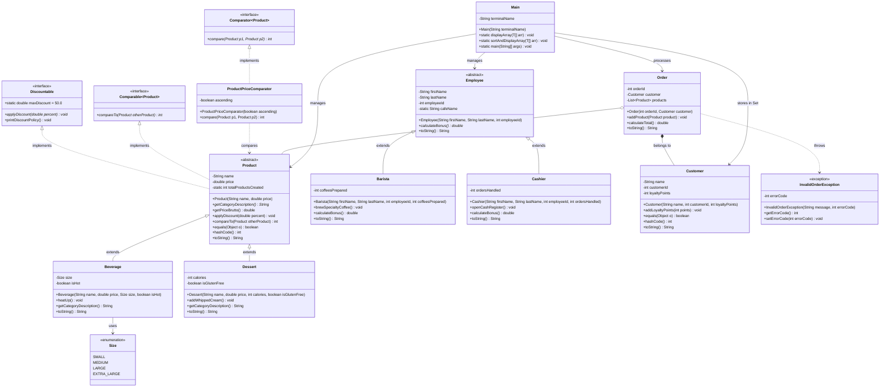

# ☕ System POS dla Kawiarni (Java OOP)

Kompleksowy, konsolowy system **Point of Sale (POS)** stworzony w języku **Java**, symulujący działanie terminalu sprzedażowego, zarządzanie menu, obsługę zamówień, program lojalnościowy oraz panel pracowników w kawiarni **„Kawiarnia Java POS”** (inicjalizowanej bazowo jako *„Java Bean Cafe”*).

Projekt został zrealizowany w celu praktycznej demonstracji zaawansowanych mechanizmów programowania obiektowego (OOP), kolekcji, typów generycznych oraz obsługi wyjątków w Javie.

---

## 📋 Spis treści
1. [Główne funkcjonalności](#-główne-funkcjonalności)
2. [Diagram klas UML (Mermaid)](#-diagram-klas-uml-mermaid)
3. [Architektura i szczegółowy opis klas](#-architektura-i-szczegółowy-opis-klas)
4. [Zastosowane mechanizmy języka Java](#-zastosowane-mechanizmy-języka-java)
5. [Wymagania i uruchomienie](#-wymagania-i-uruchomienie)
6. [Scenariusz korzystania z programu (Krok po kroku)](#-scenariusz-korzystania-z-programu-krok-po-kroku)
7. [Autor](#-autor)

---

## 🚀 Główne funkcjonalności

* **Zarządzanie Menu Kawiarni:** Przeglądanie dostępnych napojów (`Beverage`) oraz deserów (`Dessert`) wraz z automatycznym przeliczaniem cen netto na brutto ($+23\%$ VAT) oraz wizualizacją układu stolików na sali (macierz 2D).
* **Wielokryterialne Sortowanie:** Sortowanie produktów alfabetycznie po nazwie (`Comparable` + metoda generyczna) lub według ceny rosnąco i malejąco (`Comparator`).
* **Obsługa Zamówień (Koszyk):** Tworzenie rachunków, dodawanie pozycji z menu, walidacja błędów za pomocą dedykowanego wyjątku `InvalidOrderException` oraz finalizacja transakcji z wyborem metody płatności (*Gotówka*, *Karta płatnicza*, *BLIK*).
* **System Rabatowy:** Dynamiczne naliczanie rabatów procentowych na produkty zgodnie z polityką rabatową zdefiniowaną w interfejsie `Discountable` (maksymalny rabat: $50\%$).
* **Moduł Pracowników i Premii:** Zarządzanie kadrą baristów (`Barista`) i kasjerów (`Cashier`), wykonywanie akcji specjalistycznych (parzenie kaw specialty, otwieranie szuflady kasy) oraz polimorficzne wyliczanie premii pracowniczych.
* **Program Lojalnościowy i Historia Zamówień:** Baza stałych klientów oparta na zbiorze `HashSet` (z kontrolą duplikatów przez `equals` i `hashCode`), automatyczne naliczanie punktów lojalnościowych ($+5$ pkt za każdy zakupiony produkt) oraz pełny rejestr zrealizowanych zamówień w strukturze `HashMap`.

---

## 📊 Diagram klas UML (Mermaid)

Poniższy diagram przedstawia pełną architekturę obiektową systemu, uwzględniając dziedziczenie, implementację interfejsów, kompozycję oraz zależności między klasami:



---

## 🏗 Architektura i szczegółowy opis klas

Projekt składa się z **13 plików źródłowych** podzielonych na logiczne warstwy funkcjonalne:

### 1. Hierarchia Produktów i Sortowanie
* **`Product.java` (Klasa abstrakcyjna):** Bazowa klasa dla wszystkich pozycji w menu, implementująca interfejsy `Comparable<Product>` oraz `Discountable`. Przechowuje prywatne pola `name` (nazwa), `price` (cena netto) oraz statyczny licznik `totalProductsCreated` zliczający wszystkie utworzone instancje produktów. Zawiera metodę abstrakcyjną `getCategoryDescription()`, metodę obliczającą cenę z $23\%$ podatkiem VAT (`getPriceBrutto()`), implementację rabatu `applyDiscount(double percent)`, naturalne sortowanie alfabetyczne `compareTo()` oraz przesłonięte metody `equals()`, `hashCode()` i `toString()`.
* **`Beverage.java` (Klasa pochodna):** Dziedziczy po `Product`. Dodaje pola `size` (typu `Size`) oraz `isHot` (`boolean`). Zawiera dedykowaną metodę `heatUp()`, która zmienia flagę `isHot = true` i informuje o podgrzaniu napoju, a także implementuje `getCategoryDescription()`.
* **`Dessert.java` (Klasa pochodna):** Dziedziczy po `Product`. Definiuje pola `calories` (`int`) oraz `isGlutenFree` (`boolean`). Udostępnia metodę `addWhippedCream()`, zwiększającą kaloryczność deseru o $120\text{ kcal}$, oraz własną implementację `getCategoryDescription()`.
* **`Size.java` (Enum):** Typ wyliczeniowy określający dostępne rozmiary napojów: `SMALL`, `MEDIUM`, `LARGE`, `EXTRA_LARGE`.
* **`Discountable.java` (Interfejs):** Określa kontrakt rabatowania ze stałą statyczną `maxDiscount = 50.0`, metodą abstrakcyjną `applyDiscount(double percent)` oraz metodą domyślną `printDiscountPolicy()`.
* **`ProductPriceComparator.java` (Komparator):** Implementuje `Comparator<Product>`. Dzięki polu `ascending` (`boolean`) umożliwia sortowanie tablicy produktów rosnąco (`true`) lub malejąco (`false`) według ceny netto.

### 2. Hierarchia Pracowników
* **`Employee.java` (Klasa abstrakcyjna):** Reprezentuje pracownika kawiarni. Przechowuje pola `firstName`, `lastName`, `employeeId` oraz statyczne pole `cafeName`. Deklaruje abstrakcyjną metodę `calculateBonus()`.
* **`Barista.java` (Klasa pochodna):** Rozszerza `Employee` o pole `coffeesPrepared` (liczba przygotowanych kaw). Posiada metodę `brewSpecialtyCoffee()` inkrementującą licznik kaw o $1$ oraz wylicza premię w `calculateBonus()` według wzoru $\text{coffeesPrepared} \times 2.5\text{ PLN}$.
* **`Cashier.java` (Klasa pochodna):** Rozszerza `Employee` o pole `ordersHandled` (liczba obsłużonych zamówień). Udostępnia metodę `openCashRegister()`, która otwiera szufladę kasy i zwiększa licznik zamówień o $1$, oraz wylicza premię w `calculateBonus()` według wzoru $\text{ordersHandled} \times 1.5\text{ PLN}$.

### 3. Obsługa Klientów, Zamówień, Wyjątków i Terminala
* **`Customer.java`:** Modeluje uczestnika programu lojalnościowego z polami `name`, `customerId` oraz `loyaltyPoints`. Metoda `addLoyaltyPoints(int points)` dopisuje punkty do konta klienta, natomiast przesłonięte metody `equals()` i `hashCode()` (bazujące na `name` i `customerId`) gwarantują unikalność obiektów w kolekcji `HashSet<Customer>`.
* **`Order.java`:** Reprezentuje zamówienie powiązane z obiektem `Customer` oraz listą `List<Product> products` (`ArrayList`). Metoda `addProduct(Product product)` weryfikuje poprawność produktu (rzucając `InvalidOrderException` dla referencji `null` lub ceny $\le 0$), dodaje go do koszyka i przyznaje klientowi $+5$ punktów lojalnościowych. Metoda `calculateTotal()` zwraca łączną kwotę zamówienia zaokrągloną do 2 miejsc po przecinku.
* **`InvalidOrderException.java`:** Własna klasa wyjątku kontrolowanego dziedzicząca po `Exception`, zawierająca dodatkowe pole `errorCode` (`int`) do precyzyjnej identyfikacji błędów (np. kod `101` dla `null`, `102` dla błędnej ceny, `200` dla testu zabezpieczeń, `404` dla nieistniejącej pozycji z menu).
* **`Main.java`:** Główna klasa sterująca terminalem POS. Definiuje dwie metody generyczne (`displayArray` oraz `sortAndDisplayArray`), inicjalizuje wszystkie struktury danych i uruchamia interaktywną pętlę `while` obsługującą 8 opcji menu.

---

## 🛠 Zastosowane mechanizmy języka Java

| Mechanizm | Realizacja w projekcie |
| :--- | :--- |
| **Hermetyzacja** | Wszystkie pola w klasach są prywatne (`private`), a dostęp do nich odbywa się przez publiczne gettery i settery (każda metoda jest wywołana w kodzie). |
| **Dziedziczenie i Abstrakcja** | Dwie klasy abstrakcyjne (`Product`, `Employee`) i cztery klasy potomne (`Beverage`, `Dessert`, `Barista`, `Cashier`). |
| **Polimorfizm** | Polimorficzne wywołania metod `getCategoryDescription()`, `calculateBonus()`, `toString()`, `equals()` oraz `hashCode()`. |
| **Upcasting i Downcasting** | Rzutowanie w górę do tablic `Product[]` i `Employee[]` oraz jawne rzutowanie w dół w opcji nr 6 (`(Beverage)`, `(Dessert)`, `(Barista)`, `(Cashier)`). |
| **Interfejsy** | Własny interfejs `Discountable` (z polem `static` i metodą `default`) oraz interfejsy biblioteczne `Comparable<Product>` i `Comparator<Product>`. |
| **Typy i Metody Generyczne** | Metody `<T> void displayArray(T[] arr)` oraz `<T extends Comparable<T>> void sortAndDisplayArray(T[] arr)` w klasie `Main`. |
| **Kolekcje (JCF)** | `ArrayList<Product>` (koszyk zamówienia), `HashSet<Customer>` (baza unikalnych klientów), `HashMap<Integer, Order>` (historia zamówień po ID). |
| **Tablice 1D i 2D** | Tablice 1D (`menuArray`, `staffArray`, `paymentMethods`) oraz tablica 2D `int[][] tablesGrid` (układ 6 stolików w 2 rzędach). |
| **4 Rodzaje Pętli** | `while` (menu główne), klasyczna `for` (wyświetlanie menu i macierzy 2D), `do-while` (walidacja rabatu $>0$), `for-each` (iteracja po kolekcjach i pracownikach). |
| **Własne Wyjątki** | Klasa `InvalidOrderException` z kodami błędów obsługiwana w blokach `try-catch` wraz z `NumberFormatException`. |

---

## 💻 Wymagania i uruchomienie

### Wymagania
* **Java Development Kit (JDK):** wersja 11 lub nowsza (zalecana JDK 17 lub JDK 21).
* Środowisko IDE (np. IntelliJ IDEA, Eclipse, VS Code) lub terminal wiersza poleceń.

### Kompilacja i uruchomienie w terminalu

1. Sklonuj repozytorium na dysk lokalny:
   ```bash
   git clone https://github.com/Rostyagai/POS-Kawiarnia_Java_77350.git
   cd POS-Kawiarnia_Java_77350
   ```
2. Skompiluj wszystkie pliki źródłowe `.java`:
   ```bash
   javac *.java
   ```
3. Uruchom klasę główną `Main`:
   ```bash
   java Main
   ```

---

## 📖 Scenariusz korzystania z programu (Krok po kroku)

Poniższy scenariusz przedstawia pełny przepływ pracy z aplikacją od uruchomienia terminala, przez obsługę zamówienia klienta, rabatowanie, sortowanie, weryfikację pracowników i historii zamówień, aż po zamknięcie systemu.

### Krok 1: Uruchomienie aplikacji i automatyczne testy inicjalizacyjne
Po uruchomieniu programu (`java Main`), system automatycznie:
1. Tworzy dwa terminale: `Terminal Glowny #1` oraz `Terminal Barowy #2` (zmieniony setterem z `Terminal Mobilny #2`).
2. Inicjalizuje 6 produktów w menu (3 napoje i 3 desery), 4 pracowników (2 baristów, 2 kasjerów), bazę stałych klientów (`HashSet` odrzucający duplikat Adama Mickiewicza dzięki `equals` i `hashCode`) oraz mapę historii zamówień (`HashMap`) z dwoma pierwszymi zamówieniami (`ID: 1` oraz `ID: 2`).
3. Przeprowadza dwa testy zabezpieczeń wyjątku `InvalidOrderException` (próba dodania `null` do zamówienia z kodem `101` oraz testowy wyjątek z kodem `200`) i wyświetla ekran powitalny:

```text
Uruchomiono: Terminal Glowny #1 oraz Terminal Barowy #2
[Test zabezpieczen POS] Zlapano wyjatek (kod 101): Nie mozna dodac pustego produktu (null) do zamowienia!
[Test zabezpieczen POS] Test drugiego obiektu wyjatku w systemie POS.

==============================================
 WITAJ W SYSTEMIE POS: Kawiarnia Java POS
 Liczba utworzonych produktow w bazie: 6
==============================================
```

### Krok 2: Wyświetlenie menu kawiarni i układu stolików (Opcja `1`)
1. Wpisz `1` i naciśnij **Enter**.
2. Program za pomocą pętli `for` wypisuje wszystkie 6 pozycji z tablicy `menuArray` wraz z ceną netto, wyliczoną ceną brutto ($+23\%$ VAT) oraz polimorficznym opisem kategorii:
   ```text
   --- AKTUALNE MENU KAWIARNI ---
   1. Caffe Latte Classic | Cena netto: 16,00 PLN | Brutto: 19,68 PLN | Kategoria: Napoj (rozmiar: EXTRA_LARGE)
   2. Espresso | Cena netto: 9,00 PLN | Brutto: 11,07 PLN | Kategoria: Napoj (rozmiar: SMALL)
   3. Mrozona Matcha | Cena netto: 19,00 PLN | Brutto: 23,37 PLN | Kategoria: Napoj (rozmiar: MEDIUM)
   4. Sernik Klasyczny | Cena netto: 18,00 PLN | Brutto: 22,14 PLN | Kategoria: Deser cukierniczy (kalorie: 430 kcal)
   5. Brownie Czekoladowe | Cena netto: 15,50 PLN | Brutto: 19,07 PLN | Kategoria: Deser cukierniczy (kalorie: 380 kcal)
   6. Szarlotka na cieplo | Cena netto: 17,00 PLN | Brutto: 20,91 PLN | Kategoria: Deser cukierniczy (kalorie: 350 kcal)
   ```
3. Poniżej zagnieżdżona pętla `for` wyświetla układ stolików z tablicy dwuwymiarowej `int[][] tablesGrid`:
   ```text
   Uklad stolikow na sali (Tablica 2D):
   [Stolik 1] [Stolik 2] [Stolik 3] 
   [Stolik 4] [Stolik 5] [Stolik 6] 
   ```

### Krok 3: Sortowanie menu na trzy sposoby (Opcja `2`)
Wybierz opcję `2` z menu głównego, aby przetestować mechanizmy sortowania:
1. Wpisz `1` (**Alfabetycznie po nazwie**): wywoływana jest metoda generyczna `sortAndDisplayArray(menuArray)`, która korzysta z interfejsu `Comparable<Product>` i metody `compareTo()`, układając produkty od *Brownie Czekoladowe* do *Szarlotka na cieplo*.
2. Ponownie wybierz opcję `2` w menu głównym, a następnie `2` (**Rosnąco po cenie**): tablica jest sortowana za pomocą obiektu `ascPriceComparator` (`ProductPriceComparator`), ustawiając na początku najtańsze *Espresso* ($9.00\text{ PLN}$), a na końcu *Mrozona Matcha* ($19.00\text{ PLN}$).
3. Wybierz opcję `2` i podopcję `3` (**Malejąco po cenie**): obiekt `descPriceComparator` odwraca kolejność od najdroższego do najtańszego produktu.

### Krok 4: Nadanie rabatu na wybrany produkt (Opcja `4`)
Przed dodaniem produktów do koszyka kasjer decyduje się nadać rabat:
1. Wybierz opcję `4` – program wywołuje metodę domyślną interfejsu `Discountable` (`printDiscountPolicy()`), informując:
   `Maksymalny mozliwy rabat w kawiarni wynosi: 50.0%`
2. Podaj numer produktu z aktualnie posortowanego menu (np. `1`).
3. Pętla `do-while` prosi o podanie procentu rabatu (wymuszając wartość $> 0$). Po wpisaniu np. `20`, metoda `applyDiscount(20)` obniża cenę netto wybranego produktu o $20\%$ i wyświetla zaktualizowany stan obiektu.

### Krok 5: Dodawanie produktów do zamówienia i walidacja błędów (Opcja `3`)
Kasjer kompletuje bieżące zamówienie (`Order` o `ID: 3` dla klienta *Adam Mickiewicz*):
1. Wybierz opcję `3` i wpisz błędny numer produktu spoza zakresu, np. `9`. System rzuca i przechwytuje `InvalidOrderException` z kodem błędu `404`:
   `BLAD ZAMOWIENIA (kod 404): Wybrano nieistniejacy numer produktu z menu!`
2. Ponownie wybierz opcję `3` i wpisz poprawny numer produktu, np. `1`, a następnie powtórz czynność dla produktu nr `2`.
3. Każdy dodany produkt trafia na listę `ArrayList<Product>` wewnątrz obiektu `currentOrder`, klient automatycznie otrzymuje $+5$ punktów lojalnościowych za każdą pozycję, a konsola wyświetla aktualną sumę koszyka wyliczoną przez `calculateTotal()`.

### Krok 6: Finalizacja zamówienia i wybór metody płatności (Opcja `5`)
1. Wybierz opcję `5`.
2. Program sprawdza, czy koszyk nie jest pusty, po czym wyświetla dostępne metody płatności z tablicy `String[] paymentMethods`:
   `1. Gotowka`, `2. Karta platnicza`, `3. BLIK`.
3. Wpisz `3` (`BLIK`). System potwierdza realizację płatności na łączną kwotę zamówienia, zapisuje sfinalizowane zamówienie nr `3` w kolekcji `HashMap<Integer, Order> ordersMap` i automatycznie otwiera nowy, pusty koszyk o `ID: 4`.

### Krok 7: Panel pracowników, Upcasting, Downcasting i Polimorfizm (Opcja `6`)
Wybierz opcję `6`, aby uruchomić panel demonstracyjny hierarchii klas:
1. Obiekty `Beverage` i `Dessert` przypisane do referencji `Product` (**upcasting**) zostają jawnie zrzutowane w dół (**downcasting**), co pozwala wywołać metodę `heatUp()` (podgrzanie napoju *Caffe Latte Classic*) oraz `addWhippedCream()` (dodanie bitej śmietany do *Sernika Klasycznego*, zwiększając kalorie z $430$ do $550\text{ kcal}$).
2. Analogiczny downcasting na referencji `Employee` uruchamia metodę `brewSpecialtyCoffee()` u baristy Janusza Kowalskiego (zwiększając liczbę kaw z $42$ do $43$) oraz `openCashRegister()` u kasjera Piotra Wiśniewskiego (zwiększając liczbę obsłużonych zamówień z $85$ do $86$).
3. Na końcu pętla `for-each` przechodzi przez tablicę `staffArray` i polimorficznie wywołuje `calculateBonus()` dla każdego pracownika, wyświetlając ich indywidualne premie:
   * Barista Janusz Kowalski ($43 \times 2.5 = 107.5\text{ PLN}$)
   * Barista Anna Nowak ($55 \times 2.5 = 137.5\text{ PLN}$)
   * Kasjer Piotr Wiśniewski ($86 \times 1.5 = 129.0\text{ PLN}$)
   * Kasjer Katarzyna Wójcik ($65 \times 1.5 = 97.5\text{ PLN}$)

### Krok 8: Baza stałych klientów (`Set`) oraz historia zamówień (`Map`) (Opcja `7`)
Wybierz opcję `7`:
1. Program wyświetla listę zarejestrowanych klientów z kolekcji `HashSet<Customer>` wraz z ich zaktualizowaną liczbą punktów lojalnościowych.
2. Na pytanie `Chcesz dodac nowego klienta? (t/n):` wpisz `t`:
   * **Test duplikatu:** Wpisując `Adam Mickiewicz` i ID `1`, metoda `customerSet.add()` zwraca `false`, a program wyświetla ostrzeżenie: `Klient o takich danych juz istnieje w zbiorze (wykryto przez equals i hashCode)!`
   * **Dodanie nowej osoby:** Przy kolejnym wywołaniu wpisz np. `Maria Konopnicka` i ID `3` – nowy klient zostanie pomyślnie dodany do zbioru.
3. Następnie program iteruje po `ordersMap.entrySet()` i wypisuje pełną historię zrealizowanych zamówień (`ID: 1`, `ID: 2` oraz sfinalizowane w Kroku 6 zamówienie `ID: 3`).

### Krok 9: Zamknięcie systemu POS (Opcja `0`)
Wpisz `0` i naciśnij **Enter**. Zmienia to flagę `running = false`, kończy główną pętlę `while`, zamyka obiekt `Scanner` i wyświetla komunikat pożegnalny:
```text
Zamykanie systemu POS. Do widzenia!
```

---

## 👤 Autor
* **Oleksandr Rostiahai** (Nr albumu: `77350`)
* Repozytorium projektu: [POS-Kawiarnia_Java_77350](https://github.com/Rostyagai/POS-Kawiarnia_Java_77350)
